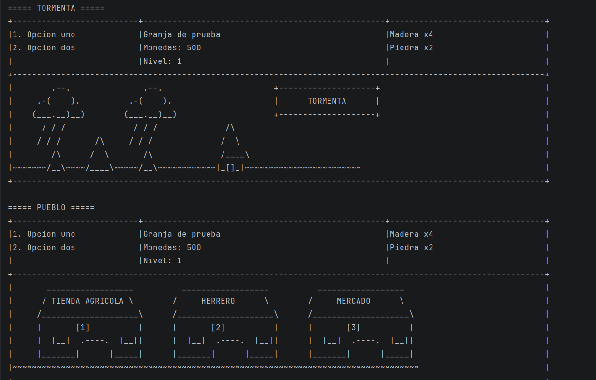
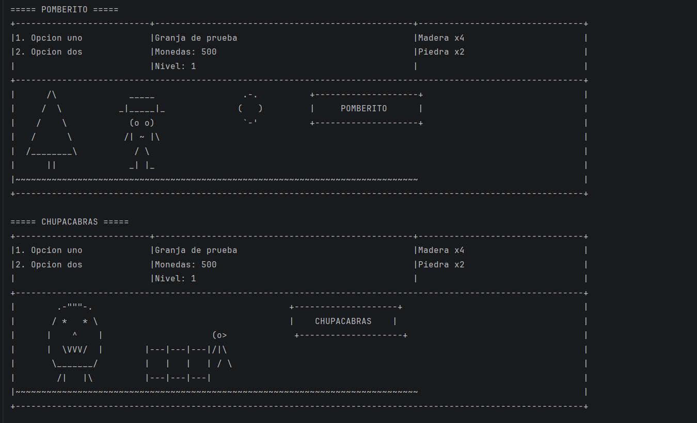

# La Estancia

Simulador de gestión rural ambientado en el campo argentino, con eventos inspirados en el folklore. Es un juego de consola desarrollado en **Java** con persistencia en **MySQL** mediante **JDBC**.

Trabajo Práctico Final de **Programación II** — Tecnicatura Universitaria en Programación, UTN Facultad Regional Mar del Plata (2026).

## Capturas




## Qué se puede hacer

**Como jugador**

- Crear una granja y administrar sus parcelas: plantar y cosechar 15 tipos de cultivos.
- Comprar y criar 15 tipos de animales en gallineros y establos, alimentarlos y recolectar lo que producen.
- Salir a recolectar recursos (talar, picar piedra y pescar) con herramientas que mejoran según su rareza: común, poco común, rara y épica.
- Visitar el pueblo:
  - **Tienda:** comprar semillas y otros productos.
  - **Mercado:** vender la producción.
  - **Herrero:** mejorar herramientas, comprar parcelas, construir gallineros y establos y mejorar el terreno, pagando con monedas y materiales.
- Completar misiones de los personajes del pueblo para ganar monedas y experiencia.
- Dormir para avanzar el día. El tiempo del juego afecta los horarios, el crecimiento de los cultivos y la aparición de eventos.
- Enfrentar eventos aleatorios del folklore (el **Pomberito**, el **Chupacabras** y las **tormentas**), eligiendo entre dos opciones con distinto riesgo y recompensa.
- Escuchar la radio de la granja mientras se juega.

**Como administrador**

- Gestionar el catálogo del juego: ítems, cultivos y tipos de animales.
- Gestionar los usuarios.

## Tecnologías

- Java (JDK 21 o superior; desarrollado con JDK 25)
- MySQL 8
- JDBC con MySQL Connector/J (incluido en `lib/`)
- `javax.sound` para la música y los efectos de sonido
- IntelliJ IDEA, Git y GitHub

## Arquitectura

El proyecto está organizado en capas, cada una con una responsabilidad:

```text
src/
├── modelo/        Entidades del juego (Partida, Animal, Cultivo, Item, Usuario…), enums y eventos
├── dao/           Acceso a datos con JDBC: un DAO por tabla, con una interfaz común
├── servicio/      Reglas del juego: granja, animales, recolección, herrero, mercado, tienda, misiones, eventos
├── menu/          Menús de consola del jugador y del administrador
├── vista/         Dibujos en ASCII de cada pantalla
├── conexion/      Conexión a la base de datos (lee la configuración de db.properties)
├── excepciones/   Excepciones propias del juego
└── util/          Utilidades: consola, reloj del juego, radio, sonido y seguridad
```

**Decisiones técnicas**

- **DAO con interfaz genérica** (`Dao<T>`) y una variante con **baja lógica** (`DaoConBajaLogica`): los registros se desactivan en lugar de borrarse.
- **Consultas con `PreparedStatement`**, para evitar inyección SQL.
- **Transacciones con rollback** en las operaciones que modifican varias tablas a la vez (compras, ventas y mejoras), para que la partida nunca quede a medias.
- **Contraseñas guardadas con hash SHA-256**, nunca en texto plano.
- **Eventos con herencia:** cada evento (`Pomberito`, `Chupacabras`, `Tormenta`) extiende la clase abstracta `Evento` y define sus propias consecuencias.
- **Configuración fuera del código:** los datos de conexión se leen de `db.properties`, que no se sube al repositorio.

## Cómo ejecutarlo

**Requisitos:** JDK 21 o superior, MySQL 8 e IntelliJ IDEA (opcional).

1. **Clonar el repositorio:**

   ```bash
   git clone https://github.com/luciomastro30-droid/LaEstancia-Progra2.git
   ```

2. **Crear la base de datos.** Ejecutar `sql/la_estancia.sql` en MySQL (por ejemplo, desde MySQL Workbench: *File → Run SQL Script*). El script crea la base `la_estancia`, sus 9 tablas y datos de prueba.

3. **Configurar la conexión.** Copiar `db.properties.example`, renombrar la copia a `db.properties` y completar el usuario y la contraseña de MySQL.

4. **Ejecutar:**
   - **Con IntelliJ IDEA:** abrir la carpeta del proyecto y ejecutar `Main`. El conector de MySQL ya está configurado como librería.
   - **Desde la terminal**, en la raíz del proyecto:

     ```bash
     javac -encoding UTF-8 -cp "lib/*" -d out $(find src -name "*.java")
     java -cp "out:lib/*" Main
     ```

     En Windows, reemplazar `:` por `;` en el classpath.

   El juego tiene que ejecutarse desde la raíz del proyecto, porque ahí busca `db.properties` y la carpeta `musica/`.

**Usuarios de prueba** (todos con la contraseña `1234`):

| Rol | Usuario |
| --- | --- |
| Administrador | `admin01` |
| Jugador | `jugador01` |

## Música

La radio reproduce los archivos `.wav` de la carpeta `musica/`, en orden alfabético. Los temas pertenecen a sus respectivos autores y se usan solo con fines académicos. Si la carpeta está vacía, el juego funciona igual, sin música.

## Mejoras pendientes

- Guardar las contraseñas con un algoritmo con *salt*, como BCrypt.
- Agregar tests automáticos con JUnit.
- Migrar el proyecto a Maven para manejar las dependencias.

## Equipo

- **Lucio Mastromarino** — [@luciomastro30-droid](https://github.com/luciomastro30-droid)
- **Máximo García** — [@MaxGarcia222](https://github.com/MaxGarcia222)
